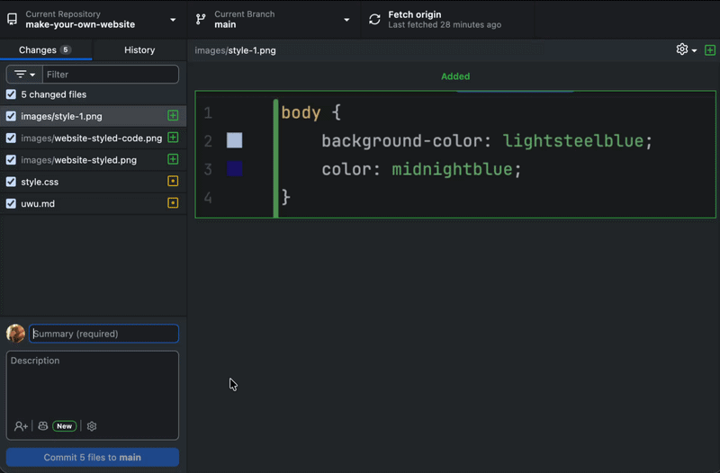
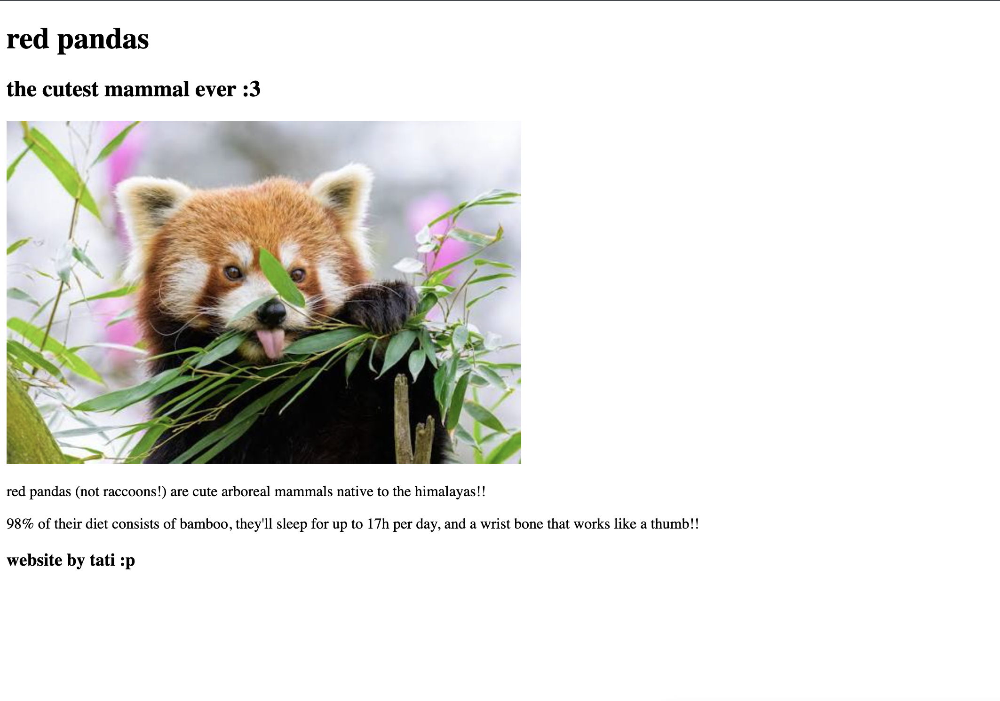
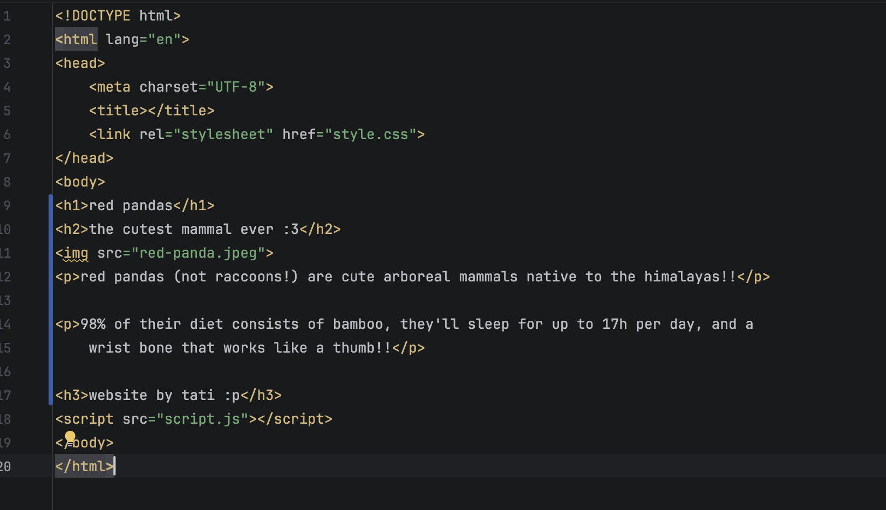
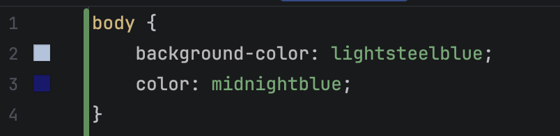
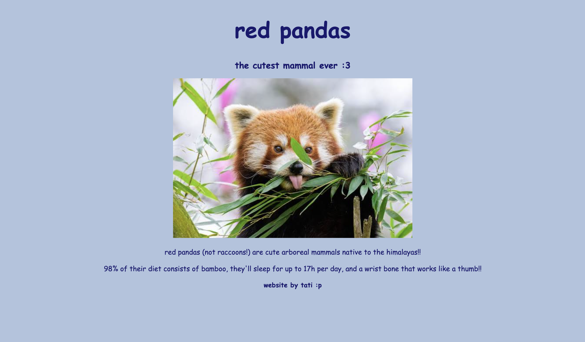
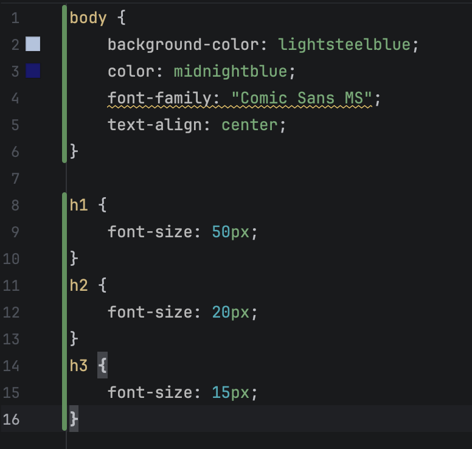
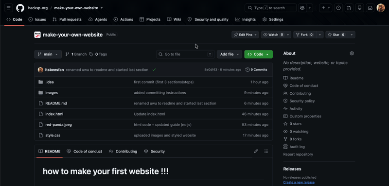
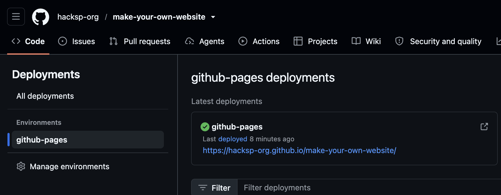

# como fazer o seu primeiro site !!!
### um guia para o Hack SP por Tatiana Morales

-----

neste guia, você poderá aprender o básico de html e css para fazer o seu primeiro site !!!

dentro deste repositório, você também poderá encontrar um exemplo de projeto para se guiar e obter alguma inspiração também :3

#### conteúdo:
1. criando o seu repositório
2. criando os seus arquivos
3. adicionando títulos, subtítulos e outros tipos de texto
4. estilizando o seu site
5. implantando (deploy) o seu site !!!

-----

## 1. criando o seu repositório!

para poder armazenar e compartilhar o seu projeto, você precisará enviá-lo e atualizá-lo em um **repositório**. para isso, usaremos o GitHub (que é a plataforma onde você está lendo isto!)

crie um novo repositório clicando no ' + ' na seção superior direita da sua tela e selecionando "New repository".

dê um nome legal ao seu repositório, uma descrição se quiser, e crie-o !!!

após criar com sucesso o seu repositório, garantiremos que você possa acessá-lo e editá-lo (ou como chamamos, fazer "commit") a partir do seu computador. para isso, você pode instalar o GitHub Desktop e fazer login com sua conta do GitHub.

agora clique na seta superior esquerda, depois em add e então em "Clone Repository"

selecione o seu repositório e clone-o para o seu computador. parabéns, você criou e clonou o seu repositório. agora a parte divertida pode começar !!

-----
## 2. criando os seus arquivos

agora que você configurou o seu repositório, é hora de programar !! para programar, você precisará de uma IDE (o aplicativo onde você escreverá e testará o seu código).
você tem várias opções, mas eu recomendo que você use o VS Code !! 

assim que você baixar o VS Code, abra a pasta do seu repositório. como você pode ver, ela está vazia. mas não se preocupe, isso não será por muito tempo !!

crie 3 arquivos diferentes:
- `index.html`
- `style.css`
- `script.js`

e finalmente, vamos garantir que os três arquivos possam se comunicar entre si. para isso, vamos entrar em `index.html`, que deve se parecer com isto:

dentro de `<head>` (entre `<head>` e `</head>`), digite `<link rel="stylesheet" href="style.css">`. isso vincula o seu arquivo css ao seu html!!

após isso, pouco antes de `</body>`, digite ``. isso vincula o seu arquivo js ao seu html!!

o seu arquivo html deve terminar parecendo algo assim:

para salvar suas alterações no repositório, abra o GitHub Desktop. nele, você verá as coisas que atualizou e os arquivos que enviou. no resumo, escreva uma breve descrição das suas alterações e clique em "Commit to main". em seguida, clique em "Push origin".
faça isso toda vez que terminar uma dessas seções!

e agora você está pronto(a) para começar a programar !!!

-----

## 3. adicionando títulos, subtítulos e outros tipos de texto

o site que estamos prestes a fazer pode ser ""dividido"" em três partes:
- texto e outros elementos simples (html)
- estilo e as coisas que "o deixam bonito" (css)
- a funcionalidade e o cérebro do site (js)

então, vamos começar com o texto e outros elementos simples dentro do nosso arquivo `index.html`.

todos os nossos elementos ficarão dentro do nosso `<body>` (ou seja, entre o `<body`> mais acima na página e o `</body>` algumas linhas antes do final do nosso código).

adicionar texto é tão simples quanto colocar o nosso texto cercado pelo nosso _elemento_.

como exemplo, você pode escrever o texto de um parágrafo cercado pelo elemento `
 e 
` bem assim:

`
olá! esta é uma linha de texto de parágrafo!!! 
`

e se você abrir o seu arquivo html no seu navegador web, é assim que ele ficaria!!

parabéns!! você escreveu sua primeira linha de código!! aqui estão alguns outros elementos que você pode usar e experimentar:

- `<h1> e </h1>`: o maior título que você pode ter.
- `<h2> e </h2>`, `<h3> e </h3>`: títulos menores
- `
 e 
`: texto de parágrafo !!
- além disso, você pode adicionar imagens usando `` (substituindo o caminho pelo caminho do seu arquivo dentro do repositório). este não tem nenhuma tag de fechamento (então nada de `</img>`!)

divirta-se experimentando e não se esqueça de fazer commit dos seus arquivos e push das suas alterações !!!

-----

## 4. estilizando o seu site

você provavelmente se divertiu usando diferentes elementos de html para tornar o site com a sua cara!! no meu caso, eu fiz sobre o meu animal favorito de todos (sim, mesmo que meu nome de usuário seja beesfan):

isso é incrível!! mas você vai notar que o seu site está parecendo um pouco... _plano_. é porque você ainda não o estilizou!

para isso, vá para o seu arquivo `style.css`! 

você provavelmente vai querer começar mudando a cor de fundo e a cor do texto do seu site. você pode fazer isso alterando `background-color` (para o fundo) e `color` (para a cor da fonte) dentro do body. deve se parecer com isto:

além disso, você pode mudar coisas como:
- fonte com `font-family:`
- tamanho da fonte com `font-size:` (embora seja melhor fazer isso dentro de tipos de texto específicos como h1 ou p)
- alinhamento de texto com `text-align: center`
- outras coisas!!

com essas opções de estilo, foi assim que o meu site acabou ficando!

tenho certeza de que você consegue deixá-lo mais bonito do que eu fiz, mas faça o seu melhor!! e não se esqueça de fazer commit dos seus arquivos e push das suas alterações !!

-----

## 5. implantando o seu site

o seu site está pronto !! ficou bem legal, não ficou? agora é hora de mostrá-lo para o mundo :> para isso, vamos usar o GitHub Pages, o serviço gratuito do GitHub para hospedar páginas web. para fazer isso, entre no seu repositório através do site do GitHub.

vá para as configurações do seu repositório, depois clique em "Pages" no canto inferior esquerdo e, abaixo de "Branch", mude "None" para "main" e clique em "Save".

e após atualizar a página, você deve vê-lo! uma implantação no lado direito da sua tela!! clique nela e ela o levará a uma página que mostra o seu link. agora o mundo pode ver o seu site!!!

----

e é isso!!! aí está o seu site e um link que você pode compartilhar com o mundo :)

(aqui está o link do meu site, a propósito: https://hacksp-org.github.io/make-your-own-website/)

_feito com <3 por tati (@itsbeesfan)_
