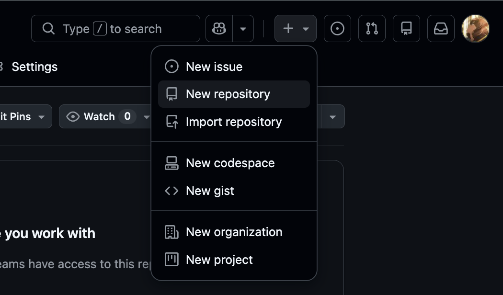
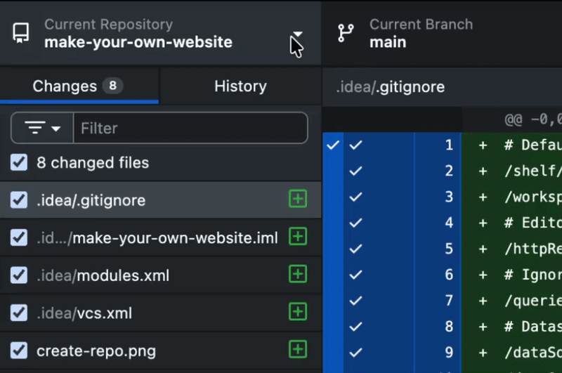
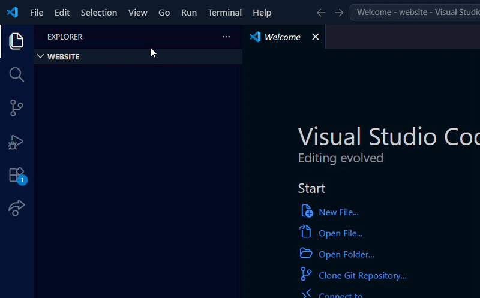
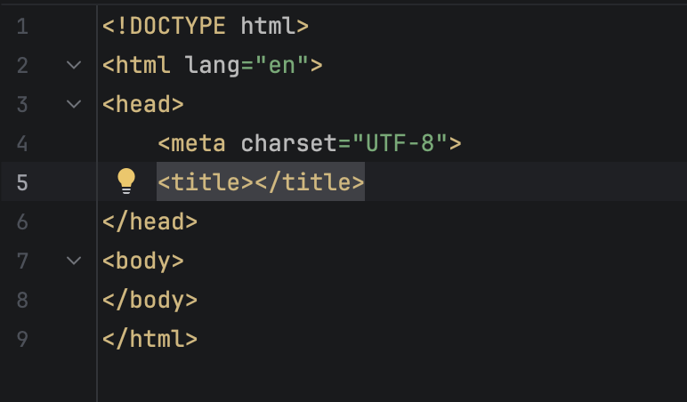
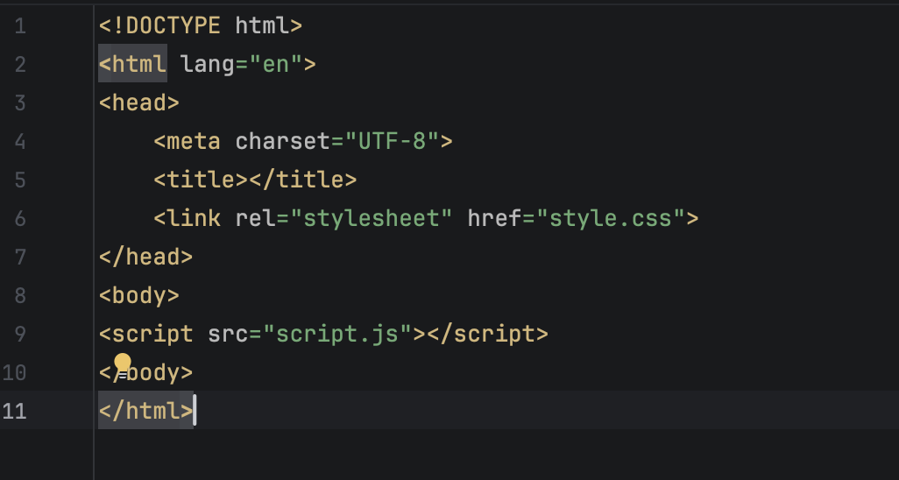

# how to make your first website !!!
### a guide for Hack SP by Tatiana Morales

-----

in this guide, you'll be able to learn the basics of html, css and js to make your very first website !!!

inside this repo, you will also be able to find an example project, for you to guide yourself and get some inspo as well :3

#### content:
1. creating your repo
2. creating your files
3. adding headings, subheadings, and other types of text
4. styling your website
5. deploying your website !!!

-----

## 1. creating your repo!

to be able to store and share your project, you'll need to upload it and update it in a **repository**. for this, we'll use GitHub (which is the platform you're reading this on!)

create a new repo clicking the ' + ' on the upper-right section of your screen and selecting "New repository".

give your repo a cool name, a description if you'd like, and create it !!!

after successfully creating your repository, we'll make sure you can access and edit it (or how we call it, "commit") from your computer. for this, you can install GitHub Desktop and log in with your GitHub account.

now click on the top left arrow, then add, and then "Clone Repository"

select your repo, and clone it to your computer. congrats, you have created and cloned your repo. now the fun stuff can begin !!

-----
## 2. creating your files

now that you've set up your repo, it's time to code !! to code, you'll need an IDE (the application where you'll be writing and testing your code).
you have plenty of choices, but i'd recommend you use VS Code !! 

once you've downloaded VSCode, open your repo folder. as you can probably see, it's empty. but don't worry, this won't be the case for long !!

create 3 different files.
- `index.html`
- `style.css`
- `script.js`

and finally, we'll make sure the three files can communicate with each other. for this, we'll enter `index.html`, it should look something like this

inside `<head>` (between `<head>` and `</head>`), type `<link rel="stylesheet" href="style.css">`. this links your css file with your html!!

after this, just before `</body>`, type ``. this links your js file with your html!!

your html file should end up looking something like this:

and now you're ready to start coding !!!

-----

## 3. adding headings, subheadings, and other types of text

the website we're about to make can be ""divided"" into three parts:
- text and other simple elements (html)
- styling and the stuff that "makes it pretty" (css)
- the functionality and brains of the site (js)

so, we're going to begin with the text and other simple elements inside our `index.html` file.

all of our elements will go inside our `<body>` (that means between the `<body`> higher up in the page to the `</body>` a few lines before the end of our code).

adding text is as simple as adding our text surrounded by our _element_.

as an example, you can write paragraph text surrounded with the element `
 and 
` just like this:

`
hello! this is a line of paragraph text!!! 
`

and if you open your html file on your web browser, here's what that would look like!!

congrats!! you've written your first line of code!! here are some other elements you can use and experiment with:

- `<h1> and </h1>`: the largest heading you can have.
- `<h2> and </h2>`, `<h3> and </h3>`: some smaller headings
- `
 and 
`: paragraph text !!
- additionally, you can add images using `` (replacing the path with your file's path inside the repo). this one doesn't have any closing tag (so no `</img>`!)

have fun experimenting !!!

-----

